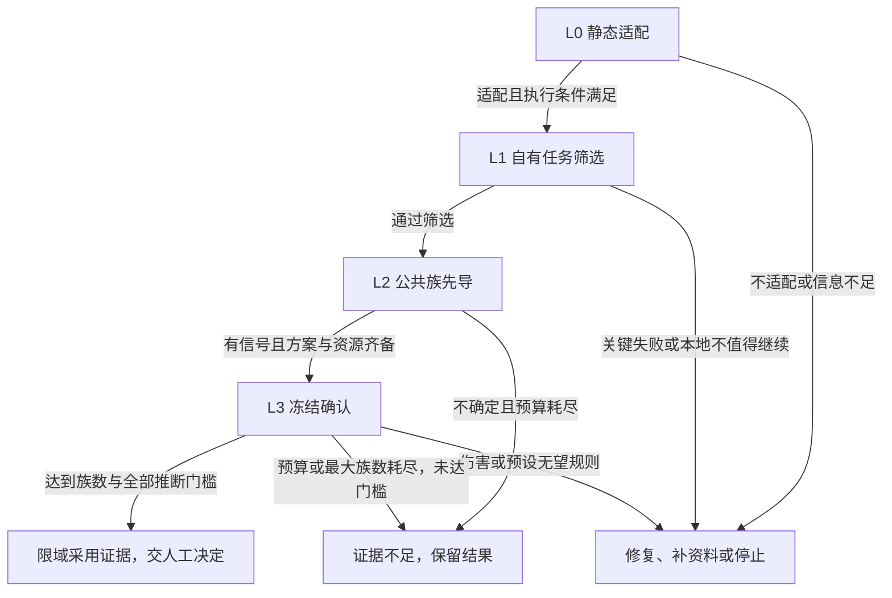

# P1：降低单次取证成本——证据阶梯与统计设计

日期：2026-10-12。状态：**DESIGN_FOR_REVIEW / NOT_IMPLEMENTED**。未记录用户接受。

本页交付设计、拟议接口和验收条件；没有执行新实验、功效模拟或付费调用，也没有为现有引擎增加序贯保证。当前入口仍是 [一页决策树](../../README.md)。机器可读配套：[设计契约](20261012-evidence-ladder.contract.json)。本文的 `evidence_stage=L0…L3` 是工具取证阶段，与 Parrhesia 的审查分档不同。

## 1. 设计决定与图中要求的对应

**把便宜的淘汰决策放在前面，把昂贵的增益确认留给通过筛选的工具。** 每一级必须输出“当前可说什么、下一步做什么、最多投入多少、什么情况停止”。序贯推断减少不必要的继续运行；部分合并利用同类任务信息；预测驱动推断优先减少人工评分量。这三种节省分别记账，不能合并成一个未经验证的“省样本率”。

| 图中要求 | 本设计的落实 | 验收入口 |
| --- | --- | --- |
| L0 静态审阅、不调用模型 | 声明、权限、出口、许可、版本五项检查；UNKNOWN 不视为通过 | 第 2 节，A01 |
| L1 自有 3–5 个任务、约 10–20 次运行 | 默认 4 个任务 × 两臂 × 2 次重复 = 16 次；只筛除或进入先导 | 第 2、3 节，A02–A03 |
| L2 公共任务族先导 | 开发集中的真实签名任务族；允许探索，不复用为确认集 | 第 2、8 节，A04 |
| L3 冻结确认研究 | 新版序贯方案与旧版固定样本方案并存；冻结后不得切换 | 第 4、9 节，A05–A08 |
| 随时有效的序贯方法 | 有界均值 CS 校验基线 + 非负检验超鞅；按族更新 | 第 5 节，A06–A09 |
| 分层贝叶斯与公共池先验 | 类型与族层次模型；先验只来自独立开发历史；接入可预测下注策略 | 第 6 节，A10–A11 |
| 少量人工 + 廉价评委且有区间 | 按族随机标注、偏差校正；固定终点 PPI 与序贯校正路径分开 | 第 7 节，A12–A15 |
| 真正降低成本 | 同一误差约束下比较运行、标注、现金与时间，失败和预留全部计入 | 第 10、12 节，A16–A18 |

**当前基础。** 仓库已经有配对评分、族级汇总、固定样本 v3、公共池候选与发送前预算预留。公共池目前是 30 个合成候选，真实专家签名与第三方托管未完成；它们不能为新方法提供经验先验或功效收益证据。[实现状态](20261012-POOL-GATEWAY.md)。

## 2. 四级证据阶梯：输入、输出与下一步

| 级别 | 输入与工作量 | 允许回答与裁决上限 | 下一步及停止条件 |
| --- | --- | --- | --- |
| **L0 静态适配** | 本地清单、版本/哈希、权限、网络出口、许可、声明能力与任务要求；目标 5–15 分钟，无模型调用 | `STATIC_FIT`：未发现明显不适配；`STATIC_BLOCKED`：已识别具体不适配；`NEEDS_INFORMATION`：待补资料。均不评价实测收益 | 不适配→放弃该用途或修复；信息缺失→列出待补字段；适配且有执行条件→冻结 L1 任务与预算 |
| **L1 自有任务筛选** | 3–5 个研究者真实任务；默认 4 × 2 臂 × 2 重复 = 16 次生成运行，范围 12–20 次；覆盖关键正例、失败/拒答、边界输入 | `STOP_HARM`：经核实的关键失败；`STOP_LOCAL_LOW_VALUE`：按预设本地实用规则不值得继续；`SCREEN_INCONCLUSIVE` 或 `ADVANCE_PILOT`。没有增益确认权限 | 严重失败立即停；不足以判断且预算用尽→不确定；通过筛选→提出 L2；所有修复换版本并重新建记录，不抹去失败 |
| **L2 公共池先导** | 与 L3 不重叠的真实开发族；建议首批 6 族，每批 +3，最多 12 族作为规划默认，具体由成本与覆盖调整；每族两臂、固定变体及重复 | 报告信号方向、异质性、方差与标注校正可行性；正向最高 **仅试用线索**，可支持规划下一步 | 无实用希望→停止；结果冲突→只针对能改变决策的疑点修复；有信号且资源够→冻结 L3；预算不足→保留先导结果，不宣称否定增益 |
| **L3 确认研究** | 事前冻结的目标、抽样框、阈值、误差预算、独立保留族、评分、停止规则和现金上限；按完整族更新 | 全部门槛通过→`SCOPED_ADOPTION_SUPPORTED`：支持在列明条件下考虑采用；未知/预算停止→证据不足；未到正向族数门槛时最高 **仅试用线索** | 人工选择接受、限定、暂缓或拒绝；版本、场景或数据分布变化触发重新评估。模型不代填用户接受 |

L1 的“一次运行”是一个任务、一个臂、一次重复的生成尝试；工具/API 子调用、评委调用、重试另计费用。失败也占运行数。人工审阅与启动耗时不被“16 次”掩盖。16 次只是设计工作量，不保证在当前 $1 预算中可完成。

L1 的筛除是限定用途的行动选择。`p>0.05` 不表示无效，未见伤害不表示安全。预设的操作规则可包括：关键数据外泄一次经核实即停；必需功能持续不可用即停止该用途；人工修正耗时超过研究者给定上限则不继续投资。可疑失败先进入 `SAFETY_HOLD`，核实后再归类，不用一次解析故障替代科学判定。

阶段转换不自动触发下一笔付费。面向用户的卡片只展示：**当前级别、已回答的问题、仍缺什么、下一步、费用/时间上限、停止原因**；推断方法和审计详情可展开。

## 3. 分析单位、目标与评分协议

**主目标**：在冻结的任务族分布、模型、工具版本和运行条件下，使用工具相对基线的等权族平均质量差。对族 f、变体 j、重复 r：

`D_f = mean_(j,r)[Q_with(f,j,r) − Q_without(f,j,r)]`，`Q ∈ [0,1]`，所以 `D_f ∈ [−1,1]`。

两个臂采用相同输入快照与评分规则；顺序随机化、上下文隔离。族内变体与重复用于稳定该族测量，不增加独立族数。共同原始文献/数据、同一模板生成的微小变化须在族识别中合并；单靠不同 ID 或哈希不能证明独立。

| 目标 | 预设阈值与条件 | 不允许的替代 |
| --- | --- | --- |
| 质量增益 | 平均差下界 `L_D > delta_gain`，并通过风险、完整性、族数等门槛 | 正均值、显著但小于实用阈值、只挑获益亚组 |
| 效率增益 | `L_D > −delta_NI` 且 `L_S > delta_saving`；S 是基线成本减工具成本，单位和边界先冻结 | 质量下降但更便宜；把现金与人工分钟随意加总 |
| 统计伤害 | `U_D < −delta_harm`，或指定风险率越界的合法检验 | 没达到增益阈值就称有害 |
| 无望/停止投资 | `U_D < delta_gain` 可表述为排除目标大小的平均增益；或冻结的预测成功概率低于阈值，仅作资源决策 | 后验成功概率低就断言无效 |

文献检索质量 rubric 在收集前冻结：相关性/召回代理、引用对主张的支持、可追溯性、应拒答时的拒答；各分量权重、缺失处理、禁区和人工裁决规则均明确。召回率需要定义可核验的参考全集，不能用“模型找到了几篇”冒充。严重捏造、越权与泄露单列风险闸门，不被平均分抵消。

超时、拒答、工具错误按预设 rubric 评分且保留原因；无法恢复的未知评分不自动填 0。每个族必须有完整两臂矩阵，或采用预先证明有效的缺失界限方法；初版未实现后者时保持 `INCOMPLETE`。测量目标是按该人工 rubric 定义的质量，不是未经验证的“客观科学真理”。

## 4. 族数下限、功效与提前停止的兼容规则

**旧路径不变**：当前 [confirmatory.py](../../value_lab/confirmatory.py) v3 仅支持 `fixed_sample`；原方案所需族数未完成，不得靠新报告选项提前宣布成功。当前 [value_metrics.py](../../value_lab/value_metrics.py) 的“低于计划最高仅试用线索”继续生效。

**拟议 v4 分开记录三个数**：

- `minimum_positive_families`：允许正向裁决的硬下限，至少 `max(30, 预设覆盖下限, 延续方案承诺的下限)`。
- `maximum_families`：在替代效应、方差/异质性、停止规则与联合成功条件下规划的最大采集族数；不是每次必须采满的正向下限。
- `observed_complete_families`：当前完成、有效、独立且可纳入的族数；变体、重复、模型评分条目均不冒充族。

新研究可在满足正向硬下限以后、达到最大族数以前，按有效序贯规则成功停止。比如“下限 30、最多 80”只说明允许检查的范围，**不是已经算得 80 族够用**。规划必须计算序贯联合功效及停止族数分布；不能直接移植固定样本的 N。延续既有计划要求 45 族时，下限仍至少 45；不能看完结果再把它改成 30。

30 是本项目政策底线与公共池建设目标，不是通用统计充分性。若新版功效、覆盖或风险指标要求更多，必须增加；预算/保留集容量不足则 `PLAN_INFEASIBLE`。可以在 30 族前因伤害、无望或预算停止，但不能正向升级。L2 永远不因恰好达到 30 就自动变成 L3。

公共池若总共只有 30 族，不能同时提供独立开发先导与至少 30 族确认集。真实建设目标应为“开发集容量 + 确认所需族数”，例如 12 + 至少 30；最终数量取决于已冻结功效计划。候选容量与签名合格容量分开显示。

## 5. 序贯引擎：先有正确性基线，再优化效率

### 5.1 可支持的抽样契约

| 契约 | 推断对象 | 初版方案 |
| --- | --- | --- |
| `iid_family_stream` | 预定分布中独立代表性任务族的期望配对差；固定族内运行协议 | 支持下述有界 CS 与检验超鞅；同源族去重，禁止按当前结果挑选下一族 |
| `finite_pool_wor` | 固定有限池中已定义的族级分值的均值，均匀无放回抽样 | 独立适配器，按无放回方法资格验收后启用；不能套 iid 检验 |
| 自选哨兵/便利样本 | 实际已观察任务的描述性差异 | 只用于 L1/L2 描述；不作代表性总体的确认推断 |

固定池不等于未来任务总体。无放回方法以池值固定、观察顺序随机为条件；随机模型生成的期望质量需要额外测量层设计，不能把一次随机完成的池均值解释为未来运行均值。按任务类型定额抽样时，各层单独建立合法 CS，再用冻结权重合成 `L=Σw_h L_h, U=Σw_h U_h`，各层分配误差预算。不能把按类型排序的数据当同分布流。[无放回方法，§1.1、定理 3.1/3.2](https://papers.nips.cc/paper_files/paper/2020/file/e96c7de8f6390b1e6c71556e4e0a4959-Paper.pdf)。

### 5.2 有限样本参考 CS

用于 iid、族均值有界的首个校验实现。令本端点总错误预算为 a，`a_n = 6a/(π²n²)`，定义：

`h_n = sqrt((2/n) × log(2/a_n))`

`C_n = [mean(D_1…D_n) − h_n, mean(D_1…D_n) + h_n] ∩ [−1,1]`。

因为 D 的区间宽度为 2，固定 n 的双侧 Hoeffding 越界概率至多 a_n；所有 n 的并集概率至多 `Σa_n=a`，所以可在任意完整族后查看与停止。区间可以再对历史取交集；空集触发数值/数据诊断，不显示零宽“确定”。这是保守的正确性参考，不保证比固定终点更省族。时间一致边界和经验 Bernstein 改进的依据见 [Howard 等，§4.1、定理 4](https://arxiv.org/html/1810.08240v9)。

### 5.3 正式候选：混合下注检验与区间反演

本项目拟议的可审计构造如下；不是声称现有代码已经实现。令 `X_f=(D_f+1)/2`。检验 `H0: E[X_f | F_(f−1)] ≤ m`，其中 `0<m<1`。选择事前固定的 `c_j∈[0,1)` 及权重 `w_j≥0, Σw_j=1`：

`M_(j,n)(m)=Π_(f≤n) [1 + (c_j/m)(X_f−m)]`

`E_n(m)=Σ_j w_j M_(j,n)(m)`。

每个因子非负，H0 下条件期望不超过 1，因此混合为初值 1 的非负超鞅；阈值 `1/a` 控制整条路径至少一次误拒的概率不超过 a。可预测的下注率也可以使用，但必须只依赖过去，满足非负性与条件期望约束。`F_(f−1)` 包含之前族和独立历史池信息，不能包含当前族未计入检验的评分。公共池先验可决定事前混合权重，不能绕过这个条件。初版权重在收集前固定；禁止事后把权重改给表现最好的整条乘积过程。

质量增益在 `m=(1+delta_gain)/2` 检验；上界通过 `1−X` 对称构造；每侧分配错误预算。固定 c、w 时 E 随 m 单调不增，可反演得到下界，边界 m=0/1 单独处理，数值根必须向保守方向舍入。上下两侧以及其他端点分别分配预算。记录 `log E`、累计越界状态、方法版本和参数；重启或暂停不重置证据。单时点 e-value 不能自动替代整个 e-process。

需要更窄 CS 时引入经资格核对的经验 Bernstein 实现，记录所用定理、范围、可预测量、数值精度与依赖版本；不自行把样本方差塞进正态区间并称为 anytime-valid。选哪一种方法在冻结前决定；运行中不取两个区间中较窄者，除非联合分配误差并使用合法组合。

### 5.4 更新、停止与多重性

预先抽取族的顺序；并行运行按该顺序提交完整族。后完成的坏结果不能因先停止而丢掉。已开始的族即使遇到统计停止也完成记录与风险核验；不再发起新族；无法完成的块阻止正向升级。墙钟早停如果依赖当前未纳入结果，只用于操作暂停，不能跳过缺失块获得正向裁决。

冻结整个研究族的错误预算：端点 × 类型层 × 插件候选 × 正式复测分支合计不超过 α。保守初版用 Bonferroni；两侧再分配。CS 内部不因查看次数另行扣款。项目换会话、改名或重试不重置 α。探索选择的获胜插件在独立 L3 再确认；确认期间试多个插件则事先调整。

判定优先级：`SAFETY_HOLD/STOP_HARM` → `INVALID/INCOMPLETE` → `STOP_BUDGET`（尚未达全部门槛）→ `SCOPED_ADOPTION_SUPPORTED`（全部门槛满足）→ `STOP_FUTILITY` → `CONTINUE/INCONCLUSIVE`。预算刚好耗尽而已完成数据满足全部门槛，可以给出相应证据，但禁止新调用；未结算/未知成本仍阻止需要成本证据的采用裁决。

## 6. 分层贝叶斯与公共池先验

目标是共享同类任务信息，估计异质性并改善后续取证分配，减少“每一类从零估计”的浪费。**可信区间不等于频率学置信区间，后验概率不直接赋予序贯采用权限。** 部分合并的基本模式与留出预测检查见 [Stan 官方案例](https://mc-stan.org/learn-stan/case-studies/pool-binary-trials-rstanarm.html)。以下为本项目模型选择设计。

1. 对二元成功端点使用层次 logistic 模型：任务类型截距、族截距、工具总效应、类型工具效应、族工具效应，以及预设顺序/重复效应。共享族截距保留两臂配对。主要效应由后验预测边际化回质量差尺度，不能把 log-odds 系数称为质量提高百分比。
2. 对 [0,1] 综合质量另选具有端点质量的有界观测模型，或将冻结 rubric 的二元分量分别建模再按权重合成。不可默认连续正态残差适合大量 0/1。高风险失败不跨类型平均消除；稀有风险单独报告区间和未知。
3. 先验来源只用与本轮确认族、文献来源组、版本及评分标签无重叠的真实开发历史。登记来源承诺、时间、任务类型映射、模型/工具版本、专家状态及适用范围；没有合格历史就使用弱信息先验，不从合成候选学习真实效应。
4. 冻结折扣/稳健混合方案和弱先验对照；用开发数据做先验预测检查。先验与新任务冲突、类型缺失或模型诊断失败时，停止用其调配资源，展示不合并结果；不能看了确认结论后选择最有利先验。
5. 第一阶段，后验仅用于 L2 规划、提出采样建议和解释异质性；L3 采样分布保持冻结。后续可让过去数据下的后验预测指导第 5.3 节可预测下注，正确性依靠检验超鞅条件，先验正确性只影响效率。改变任务类型配额需单独合法的分层推断，不能只改变抽样再保留旧估计式。

拟议二元观测式为 `Y_fjra ~ Bernoulli(p_fjra)`，`logit(p_fjra)=β0+u_type[f]+b_f+a×(βtool+v_type[f]+s_f)+γ_order×order+ρ_r`，a=0/1 为基线/工具。类型效应与族效应采用零中心层次分布，尺度参数使用正值先验；重复效应及共享输入相关性在开发数据上检查。历史信息通过冻结的稳健先验混合进入 βtool 和类型效应，混合比例、尺度与来源在 L3 前确定；没有合格历史时不建立经验先验。该模型只服务规划与解释，不以其条件独立假设替代族级频率学分析单位。

规划报告必须同时展示“弱先验/不合并”和“公共池先验”下的预期停止族数、功效、类型覆盖和先验冲突表现。只在这些条件验证后才能声称预计节省；本设计没有给出未经计算的节省百分比，也不允许把借来的历史族算作本轮 30 个独立保留族。

## 7. 预测驱动推断：廉价评委负责预测，人工负责校正

### 7.1 冻结评分目标与采集记录

每族生成两臂结果后，固定版本、提示词和 rubric 的廉价评委产生 `g_f∈[−1,1]`，预测的是**该族两臂质量差**。人工按相同 rubric 评定 `D_f`；尽可能遮蔽臂名称、工具名与廉价评分。随机一部分标注做双人评分与争议裁决，报告一致性；专家签署参考答案不等于独立评过每个生成结果。

评委训练、调参与校准按族及来源组隔离。当前确认标签不能用于训练一个回头预测同一标签的评委。交叉拟合如引入，必须以族为折单位并匹配所用推断定理。评委预测记录包括输入与输出哈希、模型/提示词/rubric 版本、成本、失败状态；人工记录包括抽样概率、盲法、时间和裁决链。

### 7.2 固定终点 PPI 路径

对两个相互独立、同目标分布的族样本 U（仅预测，N 族）和 L（预测+人工，n 族），且预测器及 λ 在独立开发数据上冻结：

`hatΔ = λ mean_U(g) + mean_L(D−λg)`。

校正项处理评委平均偏差；方差由 `λ² Var(g)/N + Var(D−λg)/n` 组成。U、L 若重叠则需要对应的协方差公式，不能继续用独立样本式。这个版本只在预设终点使用。

PPI 的预测与人工残差校正思想见 [原始论文](https://arxiv.org/abs/2301.09633v4)；[PPI++ §2、§6](https://arxiv.org/html/2311.01453v2) 对调权和效率的主要理论是渐近结论，不能给 3–5 个人工任务套上有限样本保证。初版固定终点也可对预测项和残差项分别使用有界 Hoeffding 区间并分配 α 后相加，获得保守有限样本区间；正常近似的窄区间只作明确标注的另一路径。

### 7.3 与序贯相容的有限样本路径

采用主动标注的基本思想，但明确实现本项目的有界校正版本；设计依据见 [Active Statistical Inference，ICML 2024](https://proceedings.mlr.press/v235/zrnic24a.html)。对每个新独立族：

- 在知道该族人工标签前，根据过去记录、当前输入与预测选择 `π_f∈[π_min,1]`；冻结 `π_min>0`。用可审计随机源抽 `A_f~Bernoulli(π_f)`；A=1 必须取得完整人工族标签。
- 在当前标签揭示前冻结 `g_f`，计算 `Z_f = g_f + A_f/π_f × (D_f−g_f)`；A=0 时只用 g。
- 在随机标注机制正确且没有标签选择性缺失时，`E[Z_f | D_f,g_f,π_f,过去] = D_f`。因此 iid 族流下 `E[Z_f|过去]=Δ`；无需假设廉价评委无偏。
- 使用安全范围 `Z_f∈[−B,B]`，`B=1+2/π_min`，再归一化进入第 5 节引擎；区间反演后恢复 Δ 尺度并与 [−1,1] 相交。该范围保守，可在证明后收紧。很小的 π 会扩大范围和方差，不保证节省总成本。

这给出精确序贯路径的构造要求：有效性来自随机标注、条件无偏及有界检验，不能把固定终点 PPI 区间反复查看。人工未返回时，A=1 的该族停留 `PENDING_LABEL`，不能当 A=0 跳过。有限人工硬配额用尽时只能停止取证或补充预算，不能把后续 π 设为 0 后继续宣称本路径有效。

每个新族开始前，先预留“若 A=1 时”的完整人工块时间与全部必要现金；不能抽到困难族或 A=1 后才以预算不足删除该族。未选中标注可释放该人工块预留。标注预算约束不能只按期望人工数量计算。

首次实施使用冻结常数 π 和冻结评委；主动调整 π 在独立验收后启用。人工-only 回退是冻结前选定配置，或从下一族开始按预先规定的 π=1、g=0 规则继续同一个有界过程；保留旧 Z 与原始统一边界。禁止事后重算过去数据，再从两个区间选较窄者。对关键泄露/捏造等风险，廉价评委不替代规定的人工安全核验。

标题含 anytime-valid 的研究也须读清保证类型：[Bayes-assisted PPI v1，§3–5](https://arxiv.org/html/2505.18000v1) 使用渐近 CS；列为研究候选，不作为本项目“小样本有限样本保证”的实现依据。

**实际节省是什么？** N 个廉价评分仍需要相应两臂生成结果。PPI 主要减少人工评分，不自动减少生成运行；只有证明联合效率后才合并宣传。还必须在设计中冻结 `minimum_human_labeled_families` 和类型覆盖门槛，报告人工族数、预测族数与有效区间，而不是用 N 掩盖极少人工校正。

## 8. 公共池、保留集与迁移边界

沿用 [evidence_pool.py](../../value_lab/evidence_pool.py) 的输入快照、参考答案、合法变体、禁区、专家与托管签名契约。扩展元数据应另行版本化：`task_type`、`source_group_id`、`difficulty`、`language`、`target_population`、`split`、`prior_eligible`、rubric 版本及曝光记录。任务类型建议首先覆盖：检索纳排、引用支持核验、信息不足时拒答、版本/撤稿与冲突识别；每类覆盖数与权重在目标确定后冻结，不把人为均衡比例冒充真实用户分布。

开发集供 L2、训练评委和先验估计；第三方保留集只在冻结 L3 后按协议释放，公开只给承诺与必要状态。第三方须独立于工具作者与评审专家组织；签名验证证明签名者及内容完整性，不证明其实际独立、专家资质、参考答案正确或从未泄漏。当前专家和托管方待定，状态保持 `AWAITING_EVIDENCE`。

不同工具评估可复用合格输入与专家参考材料以降低固定建设成本；重用已曝光保留集用于反复调参则转为开发集，须补充新保留族。工具生成结果只有版本、输入、宿主条件和评分协议均符合本轮计划时才可使用；不能把旧运行缓存算作新的独立证据。

## 9. 数据契约、状态恢复与代码接入

配套 JSON 是**设计契约，不是当前 CLI 支持的 suite**；使用 `design_only=true`、`implementation_status=NOT_IMPLEMENTED`，避免误运行。确认性 v4 的拟议关键字段：

| 组 | 必填内容 |
| --- | --- |
| 身份与冻结 | study_id、revision、predecessor、evidence_stage、plan_hash、外部冻结见证、confirmation_not_started、方法版本 |
| 目标与采样 | estimand、quality/efficiency 目标、抽样契约、族定义与来源分组、类型权重/配额、两臂与运行矩阵、顺序随机化 |
| 推断 | method_id、参数边界、alpha_total 及分配表、实用阈值/NI/风险阈值、min/max 族数、功效规划引用 |
| 先验与评分 | prior_source_manifest、先验折扣/回退；评委版本、人工 rubric、标注 π、人工下限与盲法、缺失策略 |
| 成本与授权 | gateway ledger/task_id、单次/累计授权、生成与评分预留、人工时间上限、未知费用处理 |
| 暂停与审计 | completed_prefix、pending_blocks、停机原因、累计检验状态、事件序列、人工决定及身份；UNKNOWN 不填成功 |

本地时间戳与哈希只提供完整性，不冒充事前注册。研究开始前需要冻结见证或可核验的外部时间记录。状态更新 append-only，事件去重；预算耗尽、用户暂停、进程崩溃后继续使用同一 study_id、α 和账本。

| 拟议纯本地接口 | 输入 → 输出 | 接入位置 |
| --- | --- | --- |
| `plan_evidence_ladder` | 任务/已有证据/约束 → 当前级别、缺口、下一步及最大工作量 | [workflow.py](../../value_lab/workflow.py)、[guidance.py](../../value_lab/guidance.py) |
| `validate_sequential_plan` | v4 计划与来源承诺 → 可冻结/缺口/不可行；不启动执行 | 新 `sequential_plan.py`；保留 v3 [confirmatory.py](../../value_lab/confirmatory.py) |
| `update_evidence_state` | 冻结计划、完整前缀、旧状态、事件 → 新状态、界限、停止理由 | 新 `sequential.py`；纯函数与持久事件层分离 |
| `propose_label_batch` | 开发历史、预测、剩余人工预算 → π、抽样请求和最大预留 | 新 `prediction_inference.py`；不直接调用评委 |
| `fit_pool_prior` | 合格开发数据与模型配置 → 来源绑定先验、诊断、适用范围 | 新 `hierarchical_planning.py`；可选依赖，不改轻量核心 |
| 现有宿主执行器 | 已批准请求 → 预算预留 → 调用 → 原始记录与结算 | [online_sandbox.py](../../value_lab/online_sandbox.py)、[gateway_budget.py](../../value_lab/gateway_budget.py) |

以上新模块名称和函数均为拟议，不存在即显示 unsupported；禁止把旧引擎输出改标签冒充新方法。新方案使用独立格式识别与 dispatcher，旧版拒绝未知方法；旧报告仍由旧规则重算。报告追加 `guarantee_kind`：`DESCRIPTIVE`、`FIXED_TIME`、`FINITE_SAMPLE_ANYTIME`、`ASYMPTOTIC`、`BAYES_MODEL_BASED`，并显示假设、已检查项和未知项。

## 10. 成本计划与网关闭环

现金、人时和运行量分别展示。设 F 族，每族 K 变体、R 重复，生成次数 `2FKR`；若两臂分别评分，廉价评委次数还需 `2FKR`（批量评分按实际计费单位）；人工标注 n 个族的完整块，另计参考答案建设、复核与争议处理。

`cash_bound = generation_reservations + judge_reservations + retry_allowance + external_service_bounds`

`human_minutes = reference_build + labeled_blocks + adjudication + operational_review`。

重用公共池主要摊薄 reference_build；PPI 主要减少 labeled_blocks；序贯停机主要减少 F；层次信息可能提高检验效率，但需验证。比较基线必须使用相同目标、错误保证、目标效应、覆盖范围和成本口径。不得只报告幸存成功研究的成本，所有筛除、失败、未知结算和预留纳入。

按用户当前规则，所有新生成、廉价评委和重试共用单次 ≤ $0.10、同一任务累计 ≤ $1.00 的授权及持久账本；预留+已结算+未知结果占用预算。下一族的全部必需调用无法获得保守预算时，不开始该族。并发预留必须原子化，恢复后不重复扣款/重复调用，结算只有可信凭据才能释放。

目前网关对固定模型按完整上下文作保守预留，仅输入包络已至少 $0.20，仍不能在当前单次上限下放行。P1 设计不会降低预留系数来制造“可运行”。后续可验证更紧的供应商计费上界、选择获授权且有可证明上界的便宜模型或本地评委；必须保留所有计费项与重试风险。这里是网关准入约束，不是供应商账户硬上限。当前 tariff 会过期，规划与执行都要重新核验其有效期。

## 11. 决策示例与失败恢复

以下均是设计案例，没有真实运行结果：

| 案例 | 必须输出 |
| --- | --- |
| L1 的 16 次中工具平均分更高，未见严重问题 | 可进入 L2；仅筛选结果，不证明增益 |
| L2 有 12 个真实族、正向信号很强 | 仅试用线索；准备独立 L3 及功效计划 |
| 30 个合成族全部完美 | SIMULATION_ONLY；专家/托管/真实证据仍未完成 |
| L3 下限 30，已完成 29 族且序贯阈值越界 | 未达正向族数门槛，最高仅试用线索；预算许可才继续 |
| 新 v4 下限 30、最大 80，40 族已满足全部门槛 | 可以停止新采集；限域采用证据交人工决定；80 并非必须采满 |
| 延续方案下限 45，40 族越界 | 不能降为 30；继续或报告未达计划 |
| 质量变好，但效率目标中的成本下界未过线 | 不支持效率升级；可保留质量观察 |
| 评委高度乐观，人工校正残差大 | 区间扩大；按冻结回退策略继续，不能删除“不一致”人工标签 |
| 被抽中人工标注的困难族迟迟未返回 | 阻止越过该族提交；保持 PENDING_LABEL |
| 预算在完成全部门槛前耗尽 | STOP_BUDGET / 证据不足，不写无用或有效 |
| 中途换 rubric、插件或保留集已曝光 | 当前确认路径失效/转探索；新版本另建计划，保留旧记录 |

## 12. 验收计划与实施顺序

### 12.1 可执行验收规格（尚未执行）

| ID | 检查 | 通过条件 |
| --- | --- | --- |
| A01 | L0 副作用 | 所有静态审阅路径调用计数为 0；五项检查 UNKNOWN 可见 |
| A02 | L1 计数与裁决 | 3–5 个任务按两臂两重复产生 12–20 个槽位；失败占槽；永不输出增益支持 |
| A03 | 安全与未知 | 经核实关键失败优先停；未知不可填通过；无伤害观察不变成安全证明 |
| A04 | 池与来源隔离 | 合成/未签名/未托管不能确认；同源族重复、开发/保留泄漏被拒绝 |
| A05 | 兼容与冻结 | v3 拒绝序贯；v4 不回溯生效；原计划下限不能降低 |
| A06 | 族数与停止 | 第 11 节 29/30、40/80、40/45 案例正确；终止原因不替换证据强度 |
| A07 | 有效性推导 | 独立核对变量范围、filtration、条件期望、误差分配与区间反演；反例输入失败关闭 |
| A08 | 重启与并发 | 去重、固定完成前缀、同一 α 与预算；逆序完成/崩溃恢复与串行重算一致 |
| A09 | 序贯数值 | 极端 0/1、全同值、n=1、大 n、下溢与边界根保守处理；不因 NaN 升级 |
| A10 | 先验治理 | 合成/重叠/错误版本拒绝借用；无历史退弱先验；先验冲突保持可见 |
| A11 | 模型与分层 | 模型诊断失败不得输出采用；预设权重不被观察频率替换；稀有风险不被合并隐藏 |
| A12 | PPI 校正 | 好/坏/反向/常数评委均保留校正；验证实际方差口径与所用采样契约一致 |
| A13 | 标注随机性 | π=0/越界、标签后选择、缺失抽样记录与选择性未返回均阻止正向裁决 |
| A14 | 区间语义 | 固定 PPI 不能 optional-stop；渐近与有限样本保证不同标签；有效范围不越界 |
| A15 | 人工与类型覆盖 | N 预测族不掩盖人工下限；标签不足/类型缺失显示 UNKNOWN 或未达门槛 |
| A16 | 现金与时间 | 生成+评委+重试共用原子预留；无法负担完整下一族不派发；人工时间独立计量 |
| A17 | 方法收益 | 同一条件下报告功效、族数分布、标注数、现金和总时间；含失败研究 |
| A18 | 用户主导 | 暂停停止派发；挑战/暂缓阻止最终采用；没有用户动作不写 accepted |

### 12.2 统计验证的具体问题、决策与成本

**本轮只设计，不执行下列正式模拟或分析。**

| 具体疑点 | 计划与会改变的决定 | 成本边界 |
| --- | --- | --- |
| 自适应查看是否增加误拒 | 对阈值边界、接近边界、最大方差、稀有失败及乱序缺失做模拟；若错误率不合格，禁止方法进入确认路径 | 本地 CPU，无 API；先用小规模测时再给完整资源报价 |
| 先验错配是否损害取证或误导类型结论 | 比较强/弱/错误先验、类型异质性和目标迁移；若不省成本或功效下降，默认关闭借用 | 与主模拟共用生成样本，避免重复生成 |
| 少标注是否真的降低总成本 | 好/差/反向/漂移评委、不同 π 和标签延迟；若人工节省被生成/评委成本抵消，保留人工-only | 首先用合成评分流；真实标注与模型运行另报计划/预算 |

冻结模拟真值、参数格、随机种子与失败判据后执行：每个关键零假设格至少 10,000 条独立轨迹，评估“整条路径任一时点误拒”，不是平均单时点覆盖。报告二项不确定性；为多格诊断分配误差，示例容忍界可预设为 `alpha+0.01` 并要求单侧上界低于该界，边界模糊则增加轨迹或保持未通过，不能只挑通过的格。模拟是实现诊断，不能代替普遍有效性的数学条件证明。

功效规划需覆盖质量/效率联合门槛、人工下限、类型覆盖、族数硬下限及停止规则；输出 `P(success by Nmax)`、平均/中位/90% 停止族数与无结论概率。更省样本的比较以满足同样目标功效和错误约束为前提，不把低功效当节省。

### 12.3 分阶段交付

1. **P1a 阶梯与本地筛选**：状态机、卡片、工作量/预算预检、公共池隔离；仍只显示既有统计保证。可独立交付，优先减少明显不适配工具的昂贵试验。
2. **P1b 有限样本序贯**：v4 计划、参考 CS、混合下注、族级事件恢复、功效与 A05–A09 验收；先支持 iid 人工评分，其他抽样契约明确拒绝。通过后才启用正向提前停止。
3. **P1c 标注节省**：先固定 π、冻结评委与有界校正，再上线主动标注；通过 A12–A16 后接入 L3。没有真实标注资源时保留工程状态。
4. **P1d 历史借用**：层次模型、先验治理、后验驱动可预测下注与分层/有限池适配器，逐项资格验收。只有匹配方法的收益证据才能改变默认配置。

快速测试层保持 <120 秒，覆盖确定性状态/边界/恢复契约；完整层覆盖可选统计依赖和较大数值对照；功效与覆盖模拟作为单独有计划、有产物的资格任务。可选依赖用 `skipUnless` 和 `requires`；发布所启用功能的验收不得以 skip 充数。不在两分钟快速层悄悄跑大模拟。

## 13. 设计审视与当前结论

**判断：条件性支持这条设计路线。** 它将淘汰、先导、确认分开，并为序贯与人工校正指定了可核验的有效性条件；若真实任务相关性、抽样/标注机制或成本包络不满足这些条件，则收窄功能或退回固定设计。尚不能判断实际节省幅度。

| 科学底线 | 当前状态与依据 |
| --- | --- |
| 数据质控 | 真实新研究尚未执行；快照、评分范围、缺失与完整矩阵已列入验收 |
| 样本/批次结构 | 设计要求族、来源组、类型、模型版本与顺序记录；真实代表性未核验 |
| 分析单位/重复 | 以族为单位；变体与重复不增加独立 n；独立性需领域审阅 |
| 方法前提 | 已区分 iid、无放回、选择性标注、模型后验与渐近保证；实现证明核对未完成 |
| 多重比较 | 已设计端点、类型、插件与复测统一 α；真实计划分配待冻结 |
| 训练/测试泄漏 | 开发/保留/评委校准隔离已设计；真实专家、保留托管与曝光核验待完成 |
| 阴性对照/基线 | 两臂基线与不合并/弱先验/人工-only 对照已设计；真实比较未运行 |

这里交付的是方法与工程设计，不是科学效果报告、独立审查结论或实现验收。最有价值的后续工作依次是：实现并核对 P1a/P1b；在合格人工标注上验证 P1c 的总成本；取得真实开发池后再评价 P1d 的迁移收益。三者均有明确改判条件，不以“更严谨”为由无限加测。

本次设计交付已检查：JSON 可解析，阶段计数与费用上限一致，18 个验收 ID 均能定位，10 个决策案例 ID 唯一，本页/入口/索引的本地链接存在；现有功能冻结检查通过且主线文档仍只有 README。上述检查属于文档与契约一致性检查，**A01–A18 的实现验收、统计模拟和真实收益验证均尚未运行**。

## 14. 方法依据与阅读范围

2026-10-12 使用原生网络工具核对公开原始论文与官方文档；AgentMuxer 仅免费能力搜索，无付费调用。核心检索概念：confidence sequences、sampling without replacement、prediction-powered inference、active statistical inference、hierarchical partial pooling。不是系统综述，不提出全球新颖性主张。

- [Howard 等，2021，Time-uniform, nonparametric, nonasymptotic confidence sequences](https://arxiv.org/html/1810.08240v9)：核对全文中的有界观测与经验 Bernstein 定理 4；为时间一致方法提供依据。
- [Waudby-Smith 与 Ramdas，2020，Confidence sequences for sampling without replacement](https://papers.nips.cc/paper_files/paper/2020/file/e96c7de8f6390b1e6c71556e4e0a4959-Paper.pdf)：核对固定有限总体的随机观察模型及定理 3.1/3.2；与 iid 路径分开。
- [Angelopoulos 等，2023，Prediction-Powered Inference](https://arxiv.org/abs/2301.09633v4)：核对摘要与版本；本设计的具体调权与方差条件另以 PPI++ 全文交叉核对。
- [Angelopoulos、Duchi、Zrnic，2024，PPI++](https://arxiv.org/html/2311.01453v2)：核对 §2、§6 与渐近效率条件；不把渐近优势写成小样本保证。
- [Zrnic 与 Candès，2024，Active Statistical Inference](https://proceedings.mlr.press/v235/zrnic24a.html)：核对会议原始记录与 [全文](https://arxiv.org/html/2403.03208v2) 的主动标注框架；本设计的有限样本校正构造仍需实现资格核对。
- [Kilian 等，2025，Anytime-valid, Bayes-assisted, Prediction-Powered Inference，v1](https://arxiv.org/html/2505.18000v1)：核对 §3–5，明确其 AsympCS 条件；不宣称核对了其后所有修订版。
- [Stan 官方部分合并案例](https://mc-stan.org/learn-stan/case-studies/pool-binary-trials-rstanarm.html)：层次二元模型与留出预测检查参考；不提供本项目的频率学或成本保证。
